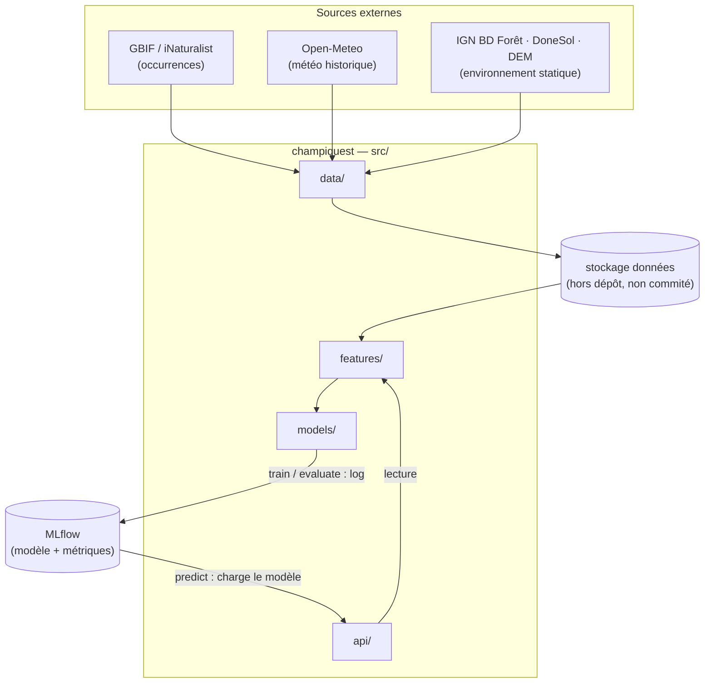
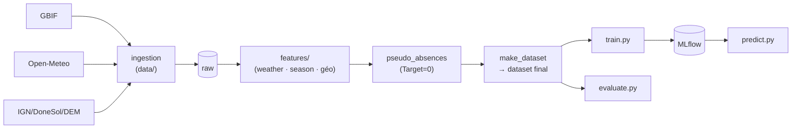
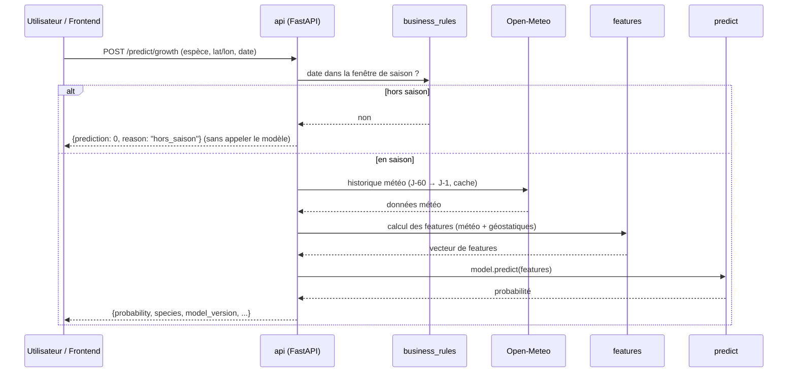

# ChampiQuest — Architecture du dépôt

> Ébauche (draft v1) — à affiner au fil de l'implémentation.
> Complète `reports/partie-1-prediction-pousse.md` (design & décisions).
> Focalisée sur la partie 1 (prédiction météo → pousse) ; parties 2 et 3 esquissées.

## 1. Principes directeurs

1. **Monorepo unique**, package `champiquest` en layout `src/`.
2. **Couches découplées** : `data` → `features` → `models` → `api`. Une couche ne
   connaît que celles situées en dessous d'elle.
3. **`train` ≠ `predict`** : l'API charge un modèle versionné via MLflow, jamais
   le code d'entraînement.
4. **Config externe** (`configs/`) : espèces, fenêtres de saison, chemins,
   hyperparamètres — modifiables sans toucher au code.
5. **Données stockées hors du dépôt** (non commitées).

## 2. Vue d'ensemble



## 3. Structure du dépôt

```
ChampiQuest/
├── .mise.toml                  # versions Python + Poetry (reproductibilité)
├── .gitignore                  # data/, mlruns/, .venv/, .env …
├── AGENTS.md                   # règles de collaboration
├── pyproject.toml              # Poetry (deps + métadonnées)
├── poetry.lock                 # versions exactes des deps
├── configs/
│   ├── species.yaml            # espèces, taxonKey GBIF, fenêtres de saison
│   └── model.yaml              # features, hyperparams, version du modèle
├── notebooks/                  # EDA / exploration uniquement
├── reports/                    # design & architecture (docs)
├── src/champiquest/
│   ├── config.py               # charge YAML + variables d'environnement
│   ├── data/
│   │   ├── gbif.py             # ingestion occurrences (bbox Alsace)
│   │   ├── openmeteo.py        # historique météo + cache
│   │   ├── environnement.py    # IGN BD Forêt, DoneSol, DEM
│   │   ├── pseudo_absences.py  # génération Target=0
│   │   └── make_dataset.py     # orchestration → dataset final
│   ├── features/
│   │   ├── weather.py          # agrégats courts/longs, choc thermique, bilan hydrique
│   │   └── season.py           # percentiles 5/95 + buffer 14j
│   ├── models/
│   │   ├── train.py            # LightGBM + log MLflow
│   │   ├── evaluate.py         # métriques + CV par blocs annuels
│   │   └── predict.py          # inférence (indépendant de train)
│   └── api/
│       ├── main.py             # app FastAPI
│       ├── schemas.py          # Pydantic (contrat entrée/sortie)
│       ├── business_rules.py   # filtre hors-saison
│       └── routers/
│           ├── growth.py       # partie 1
│           └── species.py      # partie 2 (à venir)
├── tests/                      # (créés sur demande explicite)
└── .github/workflows/
    └── ci.yml                  # lint + tests
```

## 4. Responsabilités par couche

| Couche | Rôle | N'importe **pas** |
|---|---|---|
| `data/` | Ingestion (GBIF, Open-Meteo, environnement), génération des pseudo-absences, assemblage du dataset | `models/`, `api/` |
| `features/` | Calcul des features météo (fenêtres 14/60 j) et géostatiques, calcul des fenêtres de saison | `models/`, `api/` |
| `models/` | Entraînement LightGBM + évaluation + inférence ; log MLflow | `api/` |
| `api/` | Exposition HTTP, règles métier, chargement du modèle MLflow, calcul des features à la volée | — |

## 5. Pipeline de données



## 6. Flux d'un appel API (partie 1)



## 7. Contrat de l'API `growth` (ébauche, à affiner)

**Requête** — `POST /predict/growth` :

```json
{
  "species": "boletus_edulis",
  "latitude": 48.30,
  "longitude": 7.40,
  "date": "2026-09-20"
}
```

**Réponse (en saison)** :

```json
{
  "species": "boletus_edulis",
  "date": "2026-09-20",
  "probability": 0.82,
  "model_version": "1",
  "season_active": true
}
```

**Réponse (hors saison)** :

```json
{
  "species": "boletus_edulis",
  "date": "2026-01-15",
  "prediction": 0.0,
  "reason": "hors_saison",
  "message": "Hors de la période de fructification de l'espèce (modèle non sollicité)."
}
```

## 8. Évolutions prévues (parties 2 et 3)

- **Partie 2** : module `recognition/` (ViT/CNN, multi-angles) + router `species.py`.
- **Partie 3** : `frontend/` (Streamlit, client de l'API) + carte heatmap (`folium`).
