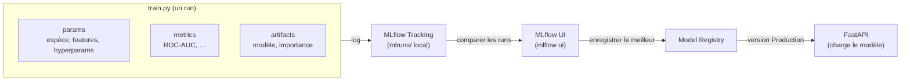
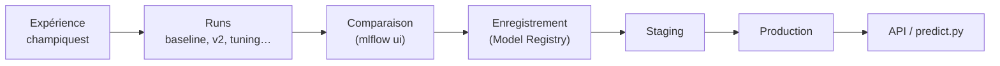
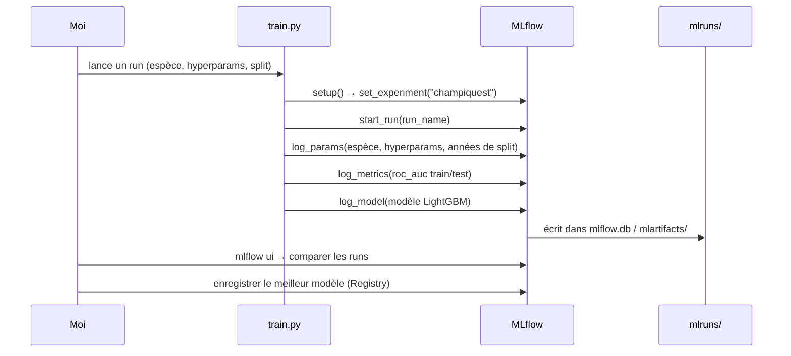

# ChampiQuest — Workflow MLflow

> Document de référence pour le suivi des expériences et des modèles.
> Complète `reports/partie-1-prediction-pousse.md` (section 7 MLOps).

## 1. Pourquoi MLflow

Pour un projet de soutenance, on doit pouvoir répondre à : *« d'où vient ce modèle,
quels paramètres, quelle performance, comment le reproduire ? »*. MLflow répond à
ces questions en traçant chaque entraînement :

- **Tracking** : params, métriques, artifacts de chaque run.
- **Model Registry** : versionner les modèles (Staging → Production) pour que
  l'API charge toujours un modèle identifié.

## 2. Notre configuration (locale, zéro infra)

- Tracking **local** : base SQLite `mlflow.db` + artifacts `mlartifacts/` (gitignorés).
- Une **expérience unique** : `champiquest` (cf. `models/mlflow_config.py`).
- Pas de serveur distant : `mlflow ui` sert à visualiser/comparer les runs en local.
- Reproductibilité : `git` (code + config + seed) = source de vérité ; MLflow =
  enregistrement des résultats, pas du code.

## 3. Workflow de tracking



## 4. Cycle de vie d'un modèle



## 5. Déroulé d'une session d'entraînement



## 6. Conventions de logging

À chaque run, on log **systématiquement** :

| Type | Contenu |
|---|---|
| `run_name` | descriptif, ex. `baseline_boletus_edulis` |
| `params` | `species`, liste des `features`, hyperparams LightGBM (`n_estimators`, `learning_rate`, `num_leaves`…), années de split |
| `metrics` | `roc_auc_train`, `roc_auc_test` (et plus tard accuracy/précision/rappel) |
| `tags` | `dataset_version`, `modele` (ex. `lightgbm`) |
| `artifacts` | le modèle (`mlflow.lightgbm.log_model`), éventuellement le graphe d'importance des features |

## 7. Commandes utiles

```bash
poetry run mlflow ui              # ouvre l'interface (http://localhost:5000)
poetry run python -m champiquest.models.train   # un run (à venir)
```

> Rappel : `mlflow.db` et `mlartifacts/` sont **gitignorés**. Sur deux machines,
> l'historique n'est pas fusionné — ce qui compte, c'est que `git` permette de
> **reproduire** un run (code + config + seed), MLflow ne servant qu'à l'enregistrer
> et le comparer.
